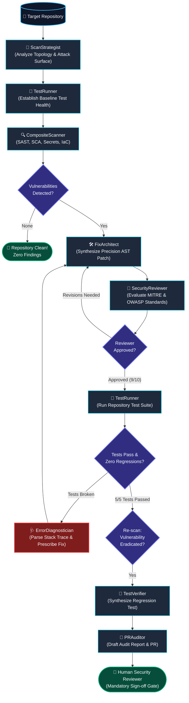
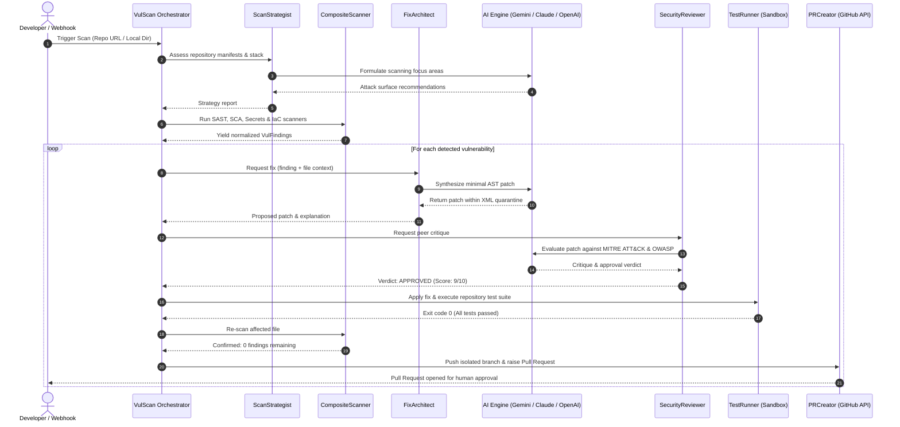

# VulScanAgent 🛡️

<div align="center">

[](.github/workflows/vulscan.yml)
[](tests/)
[](pyproject.toml)
[](docs/configuration/ai_providers.md)
[](docs/architecture/agent_threat_model.md)
[](docs/architecture/standards_compliance.md)
[](Dockerfile)

**Autonomous AI DevSecOps Security Engineer**: Scans codebases for vulnerabilities, performs context-aware AST remediation using Google Gemini, Anthropic Claude, or OpenAI, validates fixes with automated testing, and raises structured Pull Requests for human review.

[Quickstart](#-quickstart) • [Live Benchmark](#-live-benchmark-face-recognition-devops) • [Accuracy Benchmarking](docs/benchmarks/BENCHMARKING_GUIDE.md) • [Multi-Agent Architecture](#-multi-agent-collaborative-architecture) • [Presentations](#-presentation-slides--executive-demo) • [Documentation](docs/)

</div>

---

## ✨ Core Capabilities

- 🔍 **Multi-Layer Vulnerability Scanning**:
  - **SAST**: SQL Injection, Command Injection, Path Traversal, Dangerous Eval, XSS (Semgrep + built-in AST engine).
  - **Secrets**: High-entropy API keys (AWS, GitHub, OpenAI), private keys, passwords, database URLs.
  - **SCA**: Manifest auditing (`requirements.txt`, `package.json`, modern PEP 621 `pyproject.toml`, CVE tracking).
  - **IaC & Containers**: Container root executions, unpinned image tags, public port bindings (`0.0.0.0`), dangerous GitHub Actions triggers.
- 🤖 **Multi-Provider AI Fix Engine**:
  - Seamlessly route between **Google (Gemini 3.5 Flash / 3.6 Flash / Pro)**, **Anthropic (Claude 3.5 Sonnet)**, and **OpenAI (GPT-4o)**.
  - Automatic fallback cascading with exponential backoff if a provider experiences quota or demand spikes.
  - AST syntax pre-validation rejects broken code before saving to disk.
- 🧪 **Safety-Gated Test Verification**:
  - Runs repo test suites (`pytest`, `npm test`, `go test`, `mvn test`) before and after applying fixes.
  - Self-healing retry feedback loop: if a fix fails tests, error stack traces are diagnosed to prescribe corrections.
  - Automatically synthesizes targeted regression tests for the remediated vulnerability.
- 🚀 **GitHub Pull Request Automation**:
  - Handles **public and private** repositories via Personal Access Tokens.
  - Creates isolated branches (`fix/vuln-<id>`).
  - Generates comprehensive PR descriptions with CVE references, root-cause analysis, test badges, and human reviewer checklists.
- 🏛️ **Cloudflare Security Audit Skill Standard**:
  - Separation of hunting and validation: Dedicated `CandidateVerifier` adversarially challenges scanner findings to eliminate false positives.
  - Stateful `coverage-ledger.json` partitions code into bounded units to track audit completeness and prevent context drift.
  - Automatically produces Cloudflare multi-report suites: `REPORT.md`, `FINDINGS-DETAIL.md`, `NEEDS-VALIDATION.md`, and `architecture.md`.

---

## 👥 Multi-Agent Collaborative Architecture

Inspired by advanced agentic workflows (e.g. [salah9003/Automated-Vulnerability-Scanning-with-Agentic-AI](https://github.com/salah9003/Automated-Vulnerability-Scanning-with-Agentic-AI), [cloudflare/security-audit-skill](https://github.com/cloudflare/security-audit-skill), and [awesome-agent-security](https://github.com/basitalisandhu/awesome-agent-security)), **VulScanAgent** operates as a specialized multi-agent security team rather than a single generalist prompt:



| Agent Persona | Role | Primary Responsibility |
|---|---|---|
| **`ScanStrategist`** | Recon & Planning | Inspects repo topology, manifests (`package.json`, `pyproject.toml`, `Dockerfile`) and tailors attack vectors. |
| **`FixArchitect`** | Remediation | Synthesizes minimal AST code patches preserving existing coding style and business logic. |
| **`SecurityReviewer`** | Senior Critic | Critiques proposed patches against MITRE ATT&CK & OWASP standards; prevents secondary vulnerabilities. |
| **`CandidateVerifier`** | Adversarial Auditor | Cloudflare Phase 3 specialist: actively attempts to DISPROVE candidate vulnerabilities and filter false positives. |
| **`ErrorDiagnostician`** | Failure Specialist | When tests or compilation fail, parses tracebacks and provides actionable fix prescriptions. |
| **`TestVerifier`** | Verification | Coordinates test execution, monitors timeouts, and synthesizes targeted regression tests. |
| **`PRAuditor`** | Technical Writer | Compiles executive security summaries, reviewer checklists, and GitHub Pull Request documentation. |

---

## 🎯 Turn-by-Turn Sequence Flow



---

## 🧪 Live Benchmark: `face-recognition-devops`

VulScanAgent was benchmarked live against [Rohitkr2510/face-recognition-devops](https://github.com/Rohitkr2510/face-recognition-devops) (FastAPI + OpenCV Haar Cascades + Jinja2 + Docker) powered by **Google Gemini**:

### Remediation Scorecard

| Metric | Benchmark Result |
| :--- | :--- |
| **Target Repository** | `Rohitkr2510/face-recognition-devops` |
| **AI Engine Used** | Google Gemini (`gemini-3.5-flash` / `gemini-3.6-flash`) |
| **Vulnerabilities Discovered** | 2 (`[HIGH]` SCA Jinja2 CVE-2024-56326 + `[MEDIUM]` IaC Port Exposure) |
| **Vulnerabilities Remediated** | **2 / 2 (100% Remediation Rate)** |
| **Automated Test Results** | **5 / 5 Unit & Integration Tests Passed in 2.71s** |
| **Post-Patch Re-Scan** | **0 Remaining Vulnerabilities Meeting Threshold** |
| **Human Review Governance** | Zero Auto-Merge enforced; Pull Request draft generated |

### Verified Patch Diffs Applied by Gemini

```diff
# 1. pyproject.toml — Resolved CVE-2024-56326 (Jinja2 Sandbox Breakout)
 dependencies = [
   "fastapi>=0.116,<1",
-  "jinja2>=3.1,<4",
+  "jinja2>=3.1.5,<4",
   "numpy>=2.3,<3",
   "opencv-python-headless>=4.12,<5",
 ]

# 2. docker-compose.yml — Resolved Port Exposure (0.0.0.0 to Loopback)
 services:
   sightline:
     build: .
     ports:
-      - "8000:8000"
+      - "127.0.0.1:8000:8000"
     restart: unless-stopped
```

### 📑 Published Cloudflare Audit Reports
All generated audit artifacts from the benchmark run are archived in [`docs/audit_reports/face_recognition_devops/`](docs/audit_reports/face_recognition_devops/):
- **Executive Audit Scorecard:** [`docs/audit_reports/face_recognition_devops/REPORT.md`](docs/audit_reports/face_recognition_devops/REPORT.md)
- **Technical Findings Deep Dive:** [`docs/audit_reports/face_recognition_devops/FINDINGS-DETAIL.md`](docs/audit_reports/face_recognition_devops/FINDINGS-DETAIL.md)
- **Runtime Validation Ledger:** [`docs/audit_reports/face_recognition_devops/NEEDS-VALIDATION.md`](docs/audit_reports/face_recognition_devops/NEEDS-VALIDATION.md)
- **Architecture & Threat Model Map:** [`docs/audit_reports/face_recognition_devops/architecture.md`](docs/audit_reports/face_recognition_devops/architecture.md)
- **Coverage Ledger:** [`docs/audit_reports/face_recognition_devops/coverage-ledger.json`](docs/audit_reports/face_recognition_devops/coverage-ledger.json)

### 📊 Comparative Accuracy & Performance Benchmark
- **Full Benchmark Report & Confusion Matrix:** [`docs/benchmarks/ACCURACY_BENCHMARK.md`](docs/benchmarks/ACCURACY_BENCHMARK.md)
- **Benchmarking Methodology & Evaluation Guide:** [`docs/benchmarks/BENCHMARKING_GUIDE.md`](docs/benchmarks/BENCHMARKING_GUIDE.md)

---

## 📽️ Presentation Slides & Executive Demo

To present VulScanAgent to stakeholders, leadership, or engineering teams, ready-to-use presentation assets are included directly in the repository:

- 📊 **PowerPoint Presentation Deck**: [`docs/presentations/VulScanAgent-Demo-Slides.pptx`](docs/presentations/VulScanAgent-Demo-Slides.pptx)  
  *16:9 widescreen, dark cyberpunk aesthetic, card containers, code diff blocks, and embedded speaker notes.*
- 🌐 **Interactive Web Slide Deck**: [`docs/presentations/demo-slides.html`](docs/presentations/demo-slides.html)  
  *Open in any web browser with keyboard navigation (`→` / `Space` next, `←` prev, `F` fullscreen).*
- 🐍 **Repeatable Deck Builder**: [`docs/presentations/generate_pptx.py`](docs/presentations/generate_pptx.py)  
  *Python script using `python-pptx` to rebuild or customize slides.*
- 🎨 **Visual Architecture Deep Dive**: [`docs/architecture/diagrams.md`](docs/architecture/diagrams.md)  
  *Dedicated Mermaid diagrams covering threat models, defense-in-depth guardrails, and failover states.*

---

## 🚀 Quickstart

### 1. Installation

```bash
# Clone the repository
git clone https://github.com/Rohitkr2510/VulScanAgent.git
cd VulScanAgent

# Create and activate virtual environment
python -m venv .venv

# On Windows:
.venv\Scripts\activate
# On Linux/macOS:
source .venv/bin/activate

# Install dependencies
pip install -r requirements.txt
```

### 2. Configure Environment

Copy `.env.example` to `.env` and insert your credentials:

```bash
cp .env.example .env
```

Edit `.env`:
```env
# GitHub token for repository operations & PR creation
GITHUB_TOKEN=ghp_your_github_token_here

# At least one AI provider key is required:
GEMINI_API_KEY=AIzaSy...
ANTHROPIC_API_KEY=sk-ant-...
OPENAI_API_KEY=sk-...

# Default provider choice: auto | google | anthropic | openai
AI_PROVIDER=auto
```

### 3. Verify Connectivity

```bash
python main.py verify-keys
```

---

## 💻 CLI & Web Dashboard Usage

### Launch Interactive Web Dashboard & Webhooks

```bash
python main.py dashboard --port 8000
```
Open [http://localhost:8000](http://localhost:8000) to view the real-time scanning dashboard, monitor active jobs, inspect vulnerabilities, and launch new scans directly from your browser.

#### GitHub Webhooks
Configure your GitHub repository webhook to:
- **Payload URL**: `http://<your-server>:8000/api/webhook/github`
- **Content type**: `application/json`
- **Events**: `push`, `pull_request`

### Scan a Remote Repository (Public or Private)

```bash
python main.py scan --repo https://github.com/Rohitkr2510/face-recognition-devops --branch main --provider google --severity LOW
```

### Scan a Local Directory

```bash
python main.py scan --local ./my-project --provider google --severity MEDIUM
```

---

## 🐳 Docker Sandboxing

Run VulScanAgent in an isolated container to ensure tests and scanners never access your host environment:

```bash
# Using cross-platform helper scripts:
# On Windows:
.\docker-run.ps1

# On Linux/macOS:
./docker-run.sh
```

Or via Docker Compose:
```bash
docker compose up -d
docker compose logs -f
```

The web dashboard is instantly available at [http://localhost:8000](http://localhost:8000).

---

## 🤖 GitHub Actions CI/CD Integration

VulScanAgent includes a ready-to-use GitHub Action workflow in [`.github/workflows/vulscan.yml`](.github/workflows/vulscan.yml).

To enable automated scanning on every `push` and `pull_request`:
1. Add the workflow file to your repository.
2. In GitHub **Settings > Secrets and variables > Actions**, add your API keys:
   - `GEMINI_API_KEY` or `ANTHROPIC_API_KEY` or `OPENAI_API_KEY`
   - `GITHUB_TOKEN` is automatically provided by GitHub Actions!

---

## 🧪 Running Tests

Run VulScanAgent's full test suite:

```bash
pytest -v
```

All **28 tests** covering scanners, prompt quarantine parsers, AST syntax validators, HMAC webhook verification, and multi-agent roles pass in under 2 seconds.

---

## 🛡️ Enterprise Security Guardrails

Inspired by the [awesome-agent-security](https://github.com/basitalisandhu/awesome-agent-security) standard, VulScanAgent implements strict runtime controls:

- **Path Traversal Shield**: Strictly verifies all target files resolve inside the repository root; blocks directory traversal escapes (`../`).
- **Command Sanitizer**: Rejects raw shell metacharacters (`;`, `&&`, `||`, backticks) and dangerous command patterns before tool execution.
- **Automated Secret Masking**: Strips and redacts AWS keys, GitHub tokens, and API credentials from logs, console, and PR descriptions.
- **AST Pre-validation**: Parses patched code into an Abstract Syntax Tree to ensure syntax validity before touching the filesystem.
- **Zero Auto-Merge Policy**: Mandates human approval for every Pull Request; never merges code automatically.

---

## 📄 License

This project is licensed under the Apache 2.0 License - see the [LICENSE](LICENSE) file for details.
