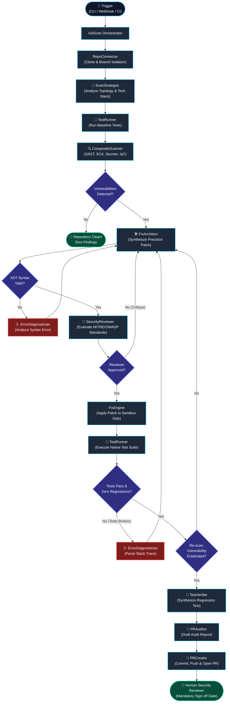
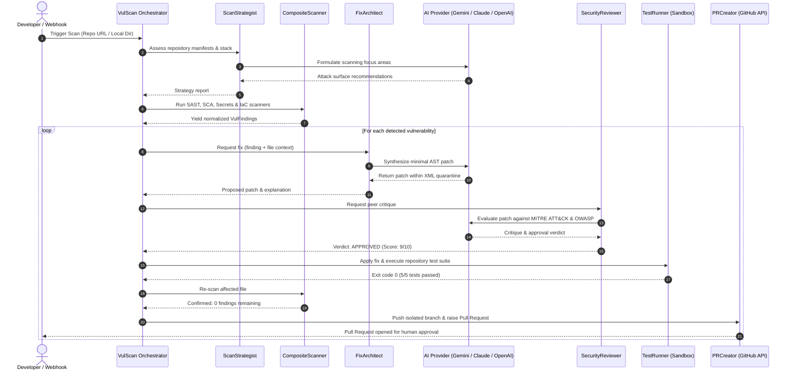
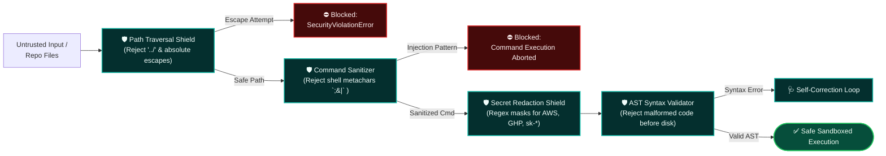
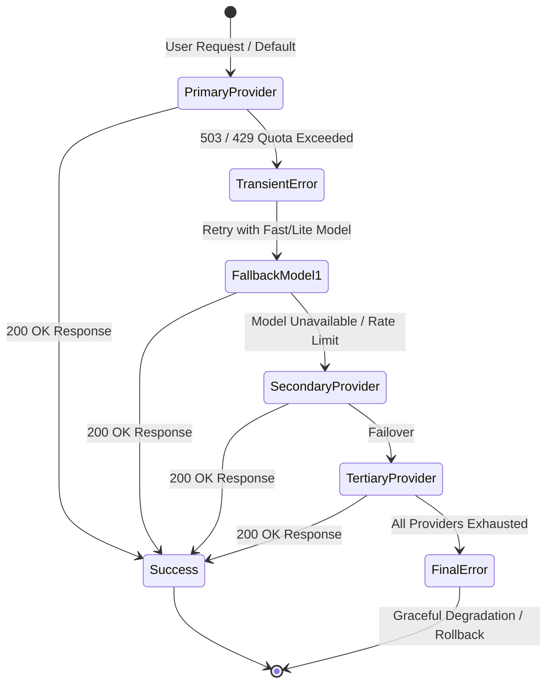

# 🎨 VulScanAgent Architecture & Visual Blueprint

This document provides visual diagrams illustrating VulScanAgent's autonomous multi-agent architecture, remediation lifecycle, failover mechanisms, and security guardrails.

GitHub natively renders all Mermaid diagrams below.

---

## 1. High-Level Multi-Agent Remediation Pipeline

The following diagram illustrates how the 6 autonomous agent roles collaborate with the scanning engines, test runner, and GitHub API:

---

## 2. Turn-by-Turn Sequence Diagram

This sequence diagram illustrates the synchronous and asynchronous messaging between the orchestrator, specialized agent roles, external AI providers, sandboxed test executions, and GitHub:

---

## 3. Defense-in-Depth Security Guardrails

VulScanAgent enforces strict zero-trust controls at every boundary to prevent AI prompt injection, unauthorized privilege escalation, path traversal, or credential disclosure:

---

## 4. Multi-Provider AI Fallback Mechanism

