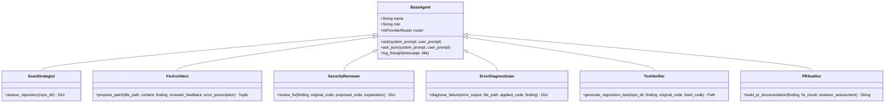

# Collaborative Multi-Agent Framework

## 1. Design Philosophy

Complex cybersecurity challenges cannot be reliably solved by a single monolithic prompt. In human security engineering teams, distinct roles exist: strategists plan the scope, software engineers craft patches, senior architects review code for side effects, QA engineers verify test suites, and compliance specialists author audit reports.

**VulScanAgent** mirrors this real-world division of labor by deploying a specialized, collaborative multi-agent team inspired by state-of-the-art agentic AI research (e.g. [AgentVerse](https://arxiv.org/abs/2308.10848) and [Communicative Agents for Software Development](https://arxiv.org/abs/2307.07924)).

---

## 2. Multi-Agent Roster

---

## 3. Detailed Agent Roles & Behaviors

### 3.1 ScanStrategist (Recon & Prioritization)
- **Role**: Application Security Strategist & Recon Specialist.
- **Responsibility**: Inspects directory trees, file extensions, and manifests (`package.json`, `requirements.txt`, `Dockerfile`, `go.mod`).
- **Output**: JSON assessment identifying primary language, high-priority scanner types, and risk hotspots.

### 3.2 FixArchitect (Remediation Specialist)
- **Role**: Application Remediation Architect & Software Engineer.
- **Responsibility**: Crafts minimal, surgically precise code modifications to eliminate vulnerabilities while preserving coding conventions, whitespace, and existing logic.
- **Input Context**: Vulnerable file, finding description, line numbers, remediation hints, plus critique from `SecurityReviewer` and prescriptions from `ErrorDiagnostician`.

### 3.3 SecurityReviewer (Senior Security Critic)
- **Role**: Senior Application Security Auditor & Critic.
- **Responsibility**: Critiques proposed code patches before they are applied.
- **Verification Criteria**:
  1. Does this fix genuinely eliminate the root vulnerability?
  2. Does it introduce secondary attack vectors (e.g., regex DOS, weak sanitization)?
  3. Does it break backward compatibility or public method signatures?
- **Output**: Structured JSON (`approved: bool`, `feedback: str`, `confidence_score: int`).

### 3.4 ErrorDiagnostician (Failure & Stack Trace Specialist)
- **Role**: Compiler & Test Failure Specialist.
- **Responsibility**: Triggered whenever AST syntax validation or test execution fails.
- **Function**: Analyzes compiler errors, Python tracebacks, or test assertion failures to isolate the exact root cause and formulate step-by-step remediation instructions for `FixArchitect`.

### 3.5 TestVerifier (QA & Security Verification Specialist)
- **Role**: Security Test Engineer.
- **Responsibility**: Generates targeted unit/regression tests verifying both:
  - Legitimate functional inputs succeed.
  - Exploit payloads (e.g. `' OR '1'='1`, `$(whoami)`, `../../etc/passwd`) are safely sanitized or rejected.

### 3.6 PRAuditor (Compliance & Technical Documentation Lead)
- **Role**: Security Compliance & Technical Documentation Lead.
- **Responsibility**: Compiles the comprehensive, production-ready Pull Request Markdown body, detailing:
  - Vulnerability severity and CVSS/rule identifiers
  - Technical root-cause explanation
  - Security Reviewer evaluation notes
  - Test verification results and execution timing
  - Human review verification checklist
