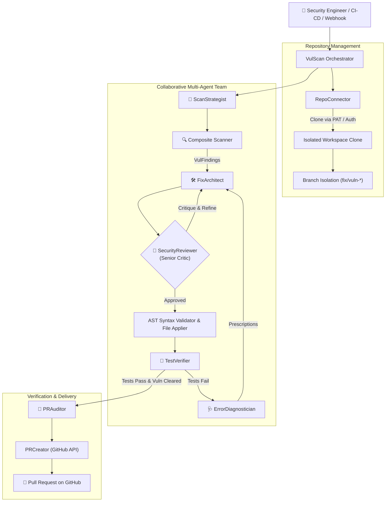
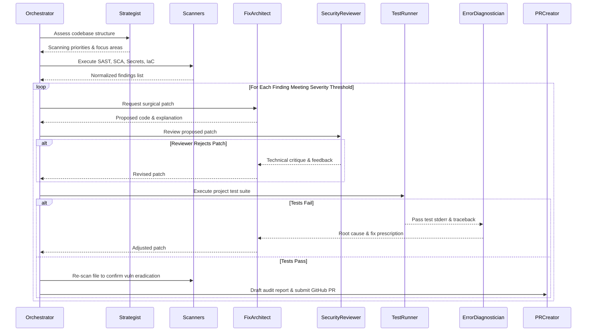

# VulScanAgent Architecture Overview

## 1. System Vision

**VulScanAgent** is an enterprise-grade autonomous security engineer designed to eliminate the manual bottleneck in application vulnerability remediation. Rather than merely detecting flaws and leaving static reports for human triage, VulScanAgent orchestrates an autonomous team of specialized AI agents that:

1. **Reconnoiter & Plan**: Analyze the target codebase topology, frameworks, and manifests.
2. **Scan & Aggregate**: Detect vulnerabilities across SAST, Secrets, SCA, and IaC vectors.
3. **Architect & Review**: Generate surgical code patches reviewed by a Senior Security Critic.
4. **Test & Validate**: Verify that existing test suites pass and synthesize targeted regression tests.
5. **Open Pull Requests**: Raise structured, fully audited PRs with checklists for human approval.

---

## 2. High-Level System Architecture

---

## 3. Core Subsystems

### 3.1 Repository Connector (`agent/repo_connector.py`)
- Provides HTTPS authenticated cloning for **public and private** repositories.
- Injects fine-grained Personal Access Tokens (`x-access-token:<token>@github.com/...`).
- Creates isolated working branches: `fix/<finding_id>`.
- Manages clean teardown and workspace purging after scanning.

### 3.2 Composite Scanner (`agent/scanner/`)
- Normalizes disparate tool outputs into a uniform schema: `VulFinding`.
- **SAST**: Semgrep integration + built-in regex & AST rules targeting SQLi, command injection, path traversal, dangerous eval, and XSS.
- **Secrets**: High-entropy token detection for AWS keys, GitHub tokens, OpenAI credentials, private keys, and passwords.
- **SCA**: Audits dependencies in `requirements.txt` and `package.json` against known CVEs.
- **IaC**: Identifies Dockerfile security risks (running as root, unpinned `latest` tags) and CI/CD workflow security flaws.

### 3.3 Multi-Provider AI Engine (`agent/ai_fix/provider_router.py`)
- Provider-agnostic abstraction layer supporting:
  - **OpenAI**: `gpt-4o`, `gpt-4o-mini`
  - **Anthropic**: `claude-3-5-sonnet-20241022`, `claude-3-opus`
  - **Google**: `gemini-2.5-pro`, `gemini-2.0-flash`
- Automatic fallback cascade: if a provider fails or experiences rate limits, requests gracefully transition to alternate providers without halting the pipeline.

### 3.4 Test Verification Engine (`agent/test_runner/`)
- Language-agnostic test auto-detection:
  - Python: `pytest`, `unittest`
  - Node.js: `npm test`, `jest`
  - Go: `go test ./...`
  - Java: `mvn test`
- Subprocess sandboxing with strict timeouts preventing infinite loops.
- Error diagnostics capture stdout and stderr for feedback to the AI team.

---

## 4. Data Flow Lifecycle

