# 📊 VulScanAgent Accuracy Benchmarking & Comparative Evaluation Guide

This guide establishes the formal methodology, statistical metrics, industry baselines, and step-by-step procedures to benchmark **VulScanAgent's** vulnerability detection and autonomous code remediation accuracy.

---

## 🎯 1. Accuracy Metric Taxonomy

Evaluating an autonomous DevSecOps agent requires measuring two distinct operational capabilities:
1. **Detection & Triage Accuracy** (Hunting & Filtering)
2. **Remediation & Verification Accuracy** (Repairing & Test Preservation)

```mermaid
flowchart TD
    classDef metric fill:#1e293b,stroke:#06b6d4,stroke-width:2px,color:#f8fafc;
    classDef group fill:#0f172a,stroke:#38bdf8,stroke-width:1.5px,color:#f8fafc;

    subgraph Detection["🔍 Detection & Verification Metrics"]
        direction TB
        M1["Precision = TP / (TP + FP)"]:::metric
        M2["Recall = TP / (TP + FN)"]:::metric
        M3["F1-Score = 2 * (P * R) / (P + R)"]:::metric
        M4["OWASP Youden's Index = TPR - FPR"]:::metric
    end

    subgraph Remediation["🛠️ Autonomous Repair Metrics"]
        direction TB
        R1["Fix Success Rate (FSR) = Fixed / Real Vulns"]:::metric
        R2["Zero Regression Rate (ZRR) = Tests Maintained"]:::metric
        R3["Self-Healing Recovery Rate = Rescued / Failures"]:::metric
        R4["Secondary Flaw Rate = New CWEs Introduced (Target: 0%)"]:::metric
    end
```



### A. Detection & Triage Metrics

| Metric | Formula | Target | Description |
|---|:---:|:---:|---|
| **True Positives ($TP$)** | Count | Maximize | Real vulnerabilities correctly flagged and confirmed by the agent. |
| **False Positives ($FP$)** | Count | Minimize | Safe, benign, or unreachable code falsely flagged as vulnerable. |
| **False Negatives ($FN$)** | Count | Minimize | Real vulnerabilities present in code that were missed. |
| **True Negatives ($TN$)** | Count | Maximize | Clean components audited and verified harmless without false alarms. |
| **Precision** | $\frac{TP}{TP + FP}$ | $\ge 90\%$ | Proportion of reported findings that are real vulnerabilities. Prevents developer alert fatigue. |
| **Recall (Sensitivity)** | $\frac{TP}{TP + FN}$ | $\ge 95\%$ | Proportion of total vulnerabilities in the codebase that were caught. |
| **$F_1$-Score** | $2 \cdot \frac{\text{Precision} \cdot \text{Recall}}{\text{Precision} + \text{Recall}}$ | $\ge 92\%$ | Harmonic mean balancing detection completeness against noise. |
| **OWASP Youden Index ($J$)** | $\text{TPR} - \text{FPR}$ | $\ge 0.85$ | Standard OWASP Benchmark score: $\frac{TP}{TP + FN} - \frac{FP}{FP + TN}$. |
| **False Positive Rejection Rate** | $\frac{\text{Disproved Candidates}}{\text{Total Scanned Candidates}}$ | $\ge 80\%$ | Efficacy of the adversarial `CandidateVerifier` in filtering scanner noise. |

### B. Remediation & Repair Metrics

| Metric | Formula | Target | Description |
|---|:---:|:---:|---|
| **Fix Success Rate (FSR)** | $\frac{\text{Successful AST Patches}}{\text{Total Confirmed Vulnerabilities}}$ | **100%** | Percentage of vulnerabilities successfully patched with valid syntax. |
| **Zero-Regression Rate (ZRR)** | $\frac{\text{Fixes with 100% Pre-Existing Tests Passing}}{\text{Total Fixes Attempted}}$ | **100%** | Guarantees business logic and functionality was not broken by the fix. |
| **Self-Healing Recovery Rate (SHRR)** | $\frac{\text{Fixes Recovered by ErrorDiagnostician}}{\text{Initial Test Failures}}$ | $\ge 75\%$ | Efficacy of the feedback retry loop diagnosing compiler/test stack traces. |
| **Secondary Flaw Rate (SFR)** | $\frac{\text{Fixes Introducing New CWE Flaws}}{\text{Total Fixes Attempted}}$ | **0.0%** | Re-scan verification ensuring the patch did not introduce secondary bugs. |

---

## 🏆 2. Three-Tier Comparative Benchmark

To prove the superiority of VulScanAgent, benchmark results should be compared against three standard paradigms:

| Evaluation Dimension | Traditional SAST / SCA (e.g. Semgrep, Bandit, Trivy) | Single-Prompt LLM (Raw GPT-4o / Claude / Gemini) | VulScanAgent (Collaborative Multi-Agent) |
|---|:---:|:---:|:---:|
| **Architecture** | Rule-based regex/AST matching | Single generalist prompt | 7-agent role separation + Cloudflare 6-phase lifecycle |
| **False Positive Noise** | ❌ High ($>35\%$ false alarms) | ⚠️ Moderate hallucinations | **✅ Low ($<5\%$ via Adversarial CandidateVerifier)** |
| **Scanning Breadth** | ⚠️ Single-engine silo | ❌ No native AST scanner | **✅ SAST + SCA + Secrets + IaC** |
| **Remediation Capability** | ❌ None (alerts only) | ⚠️ Unchecked raw diffs | **✅ Precision AST patches with style preservation** |
| **Test Verification** | ❌ None | ❌ None (blind output) | **✅ TestRunner sandbox + automated regression test generation** |
| **Self-Healing Loop** | ❌ None | ❌ None | **✅ ErrorDiagnostician traceback parsing** |
| **Zero-Regression Protection** | ❌ None | ⚠️ Often breaks code | **✅ Automated rollback on test regression** |
| **Enterprise Governance** | ❌ None | ❌ Danger of direct commits | **✅ Zero Auto-Merge enforced; rich PR previews** |

---

## 📂 3. Industry Benchmark Datasets

You can run VulScanAgent against standardized external test suites:

1. **[OWASP Benchmark v1.2](https://owasp.org/www-project-benchmark/)**:
   - ~2,740 test cases covering SQLi, Command Injection, Path Traversal, XSS, Weak Crypto, and LDAP.
   - Known ground truth matrix allows exact calculation of $TP, FP, FN, TN$ and Youden's Index ($J$).
2. **[NIST SAMATE / Juliet Test Suite](https://samate.nist.gov/SARD/test-suites)**:
   - Thousands of synthetic programs designed specifically for CWE validation across C/C++, Java, and Python.
3. **[Meta CyberSecEval (2 & 3)](https://github.com/meta-llama/PurpleLlama)**:
   - Industry benchmark evaluating LLM vulnerability exploitation, code generation risks, and automated security repair.
4. **[SWE-bench / SWE-bench Verified](https://www.swebench.com/)**:
   - Real-world GitHub issues and Pull Requests from production open-source Python codebases with regression unit tests.

---

## ⚡ 4. How to Run VulScanAgent's Built-In Benchmark

VulScanAgent includes a built-in automated benchmark evaluation command:

```bash
python main.py benchmark --manifest tests/benchmark/face_recognition_truth.json --local test_target_repo --provider google
```

### CLI Arguments:
- `--manifest, -m`: Path to ground truth JSON manifest defining expected vulnerabilities and benign negative cases.
- `--local, -l`: Target local repository directory to evaluate.
- `--repo, -r`: Target remote GitHub repository URL.
- `--provider, -p`: AI engine (`google`, `anthropic`, `openai`).
- `--output, -o`: Output path for the Markdown benchmark scorecard (default: `docs/benchmarks/ACCURACY_BENCHMARK.md`).

### Sample Terminal Scorecard Output:
```text
📊 Benchmark Scorecard: face-recognition-devops-security-benchmark (google)
┌──────────────────────────────────┬────────────────────┬───────────────────────────┐
│ Evaluation Metric                │      Score / Count │ Benchmark Target          │
├──────────────────────────────────┼────────────────────┼───────────────────────────┤
│ Detection Precision              │             100.0% │ >= 90% (Low False Positives)
│ Detection Recall                 │             100.0% │ >= 95% (High Coverage)   │
│ F1-Score                         │             100.0% │ >= 92% (Harmonic Mean)   │
│ Overall Accuracy                 │             100.0% │ >= 90%                    │
│ OWASP Youden's Index (TPR - FPR) │                1.0 │ >= 0.85 (Industry Std)    │
│ Fix Success Rate (FSR)           │             100.0% │ 100% (Clean Compiles)     │
│ Zero Regression Rate (ZRR)       │             100.0% │ 100% (Tests Maintained)   │
│ False Positive Rejection Rate    │             100.0% │ Adversarial Filtering     │
│ Execution Time                   │              4.82s │ Fast Autonomous Cycle     │
└──────────────────────────────────┴────────────────────┴───────────────────────────┘

📐 Confusion Matrix
┌───────────────────┬──────────────────────┬─────────────────┐
│                   │ Predicted Vulnerable │ Predicted Clean │
├───────────────────┼──────────────────────┼─────────────────┤
│ Actual Vulnerable │        TP: 2         │      FN: 0      │
│ Actual Clean      │        FP: 0         │      TN: 1      │
└───────────────────┴──────────────────────┴─────────────────┘
```

---

## 📝 5. Defining Custom Ground Truth Manifests

To benchmark any new target repository, create a JSON manifest following this schema:

```json
{
  "suite_name": "my-service-security-benchmark",
  "target_repo": "my-org/my-service",
  "description": "Benchmark suite for payment microservice",
  "ground_truth": [
    {
      "id": "GT-01-SQLI",
      "file_path": "api/routes/users.py",
      "line_number": 42,
      "category": "SAST",
      "cwe": "CWE-89",
      "is_vulnerability": true,
      "description": "Raw string concatenation in SQL execute statement"
    },
    {
      "id": "GT-02-CLEAN-HANDLER",
      "file_path": "api/routes/health.py",
      "line_number": 15,
      "category": "SAST",
      "is_vulnerability": false,
      "description": "Clean healthcheck endpoint to verify false positive rejection"
    }
  ]
}
```
