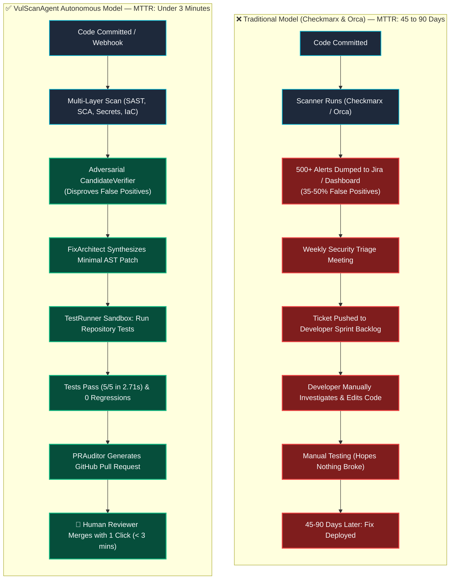

# ⚔️ Competitive Showcase: VulScanAgent vs. Checkmarx & Orca Security

> **Executive Whitepaper**: Why traditional DevSecOps and Cloud Security tools fail the modern developer, and how VulScanAgent transforms security from a passive alert bottleneck into an autonomous engineering partner.

---

## Executive Summary

Enterprises spend hundreds of thousands of dollars annually deploying legacy security solutions like **Checkmarx** (SAST/SCA) and **Orca Security** (CNAPP/CSPM). Yet despite these investments, enterprise **Mean Time to Remediate (MTTR)** remains stagnant between **45 and 90 days**, and developer satisfaction with security tooling sits at an all-time low.

The core failure is structural:
- **Checkmarx is an Alert Dumper**: It scans code, identifies potential weaknesses, and floods developer backlogs with hundreds of unverified Jira tickets—up to 50% of which are false positives. It cannot write code, test fixes, or verify regressions.
- **Orca Security is a Late-Stage Observer**: It snapshots cloud disks out-of-band in production. By the time it flags a container misconfiguration or vulnerable package, the vulnerable asset is already running live in production—disconnected from the developer's Git workflow.
- **VulScanAgent is an Autonomous Security Engineer**: It does not just find vulnerabilities; it **adversarially verifies them**, writes **precision AST code patches**, executes the repository's **automated test suite** to guarantee zero regressions, and opens **structured GitHub Pull Requests** for human approval in **under 3 minutes**.

---

## 📊 10-Point Head-to-Head Comparison Matrix

| Evaluation Dimension | Checkmarx (Checkmarx One) | Orca Security (CNAPP) | VulScanAgent (Multi-Agent AI) |
|---|---|---|---|
| **1. Tool Philosophy** | Passive alert generator for AppSec | Passive cloud infrastructure monitor | **Autonomous DevSecOps repair engineer** |
| **2. Operational Stage** | Pre-commit / CI static code only | Post-deployment cloud runtime (Shift-Right) | **Full Inner Loop (Pre-commit $\to$ CI $\to$ PR)** |
| **3. Automated Code Repair** | ❌ **None** (generic text documentation) | ❌ **None** (dashboard posture score) | **✅ 100% Autonomous AST code patching** |
| **4. Test & Regression Verification** | ❌ **None** (zero execution capability) | ❌ **None** (passive disk snapshot) | **✅ Executes repo test suite (`pytest`, `npm test`)** |
| **5. Self-Healing Feedback Loop** | ❌ **None** | ❌ **None** | **✅ ErrorDiagnostician diagnoses stack traces** |
| **6. False-Positive Filtering** | ❌ Notorious noise ($35\% - 50\%$ FP rate) | ⚠️ Cloud context scoring | **✅ Adversarial `CandidateVerifier` actively disproves** |
| **7. Multi-Layer Surface** | SAST & SCA code files only | Cloud infrastructure, VMs & OS packages | **SAST + SCA (PEP 621) + Secrets + IaC (Docker/Compose)** |
| **8. Developer Experience** | 300-page PDF reports / Jira ticket storm | SecOps dashboards & Slack alerts | **Ready-to-merge GitHub Pull Request with diffs** |
| **9. Human-in-the-Loop Governance**| Manual developer triage meetings | Manual cloud posture reviews | **Zero Auto-Merge Policy: AI proposes, human approves** |
| **10. Mean Time to Remediate** | **45 – 90 days** | **30 – 60 days** | **< 3 minutes (End-to-End PR)** |

---

## 📉 The Legacy Alert Trap vs. The Autonomous Workflow

---

## 🔍 Deep Dive: Why VulScanAgent Outperforms Each Tool

### 1. VulScanAgent vs. Checkmarx (CxSAST / CxSCA)

#### Checkmarx's Fatal Weakness: The "Ticket Avalanche"
Checkmarx scans code syntax trees using generic data-flow rules. Because it lacks runtime awareness and framework semantics, it aggressively flags code patterns regardless of whether they are reachable, sanitized, or dead code. In a typical enterprise repository, a Checkmarx scan generates **hundreds of tickets**, leading to developer apathy, alert fatigue, and conflict between engineering and security teams.

#### The VulScanAgent Advantage:
1. **Adversarial Validation (The Cloudflare Principle)**:
   - VulScanAgent enforces separation of duties: *"The agent that hunts is never the agent that validates."*
   - Before a finding is accepted, the adversarial `CandidateVerifier` agent actively challenges the scanner finding, analyzing sanitizers, parameterization, and dead code to discard false positives before a human ever sees them.
2. **Context-Aware AST Remediation**:
   - Instead of generic advice ("sanitize input"), VulScanAgent's `FixArchitect` reads the exact AST context and synthesizes a drop-in patch adhering to the repo's coding conventions, import structures, and framework idioms.
3. **Automated Test Validation**:
   - Checkmarx cannot run code. VulScanAgent executes the project's actual test suite (`pytest`, `npm test`, `go test`) inside a secure sandbox. If a fix causes a test regression or breaks existing endpoints, the fix is immediately reverted and passed to `ErrorDiagnostician` for correction.

---

### 2. VulScanAgent vs. Orca Security (CNAPP / SideScanning)

#### Orca Security's Fatal Weakness: "Too Late and Disconnected from Code"
Orca's primary innovation is out-of-band "SideScanning" of virtual machine block storage and cloud control planes. While effective for cloud infrastructure inventory, it suffers from a fundamental operational disconnect:
- **It flags issues in production**: By the time Orca detects that container port `8000` is exposed on all network interfaces (`0.0.0.0`) or that an outdated Python package is installed, the image is already baked, deployed, and running live.
- **It cannot touch the code repository**: Orca has no mechanism to edit `docker-compose.yml`, pin versions in `pyproject.toml`, or open a Git Pull Request. It generates an alert on a SecOps dashboard, requiring a human analyst to manually file a ticket for an infrastructure engineer.

#### The VulScanAgent Advantage:
1. **True Shift-Left Remediation**:
   - VulScanAgent intercepts IaC misconfigurations (`docker-compose.yml`, `Dockerfile`, Kubernetes manifests) directly in the developer's repository before deployment.
2. **Instant Closed-Loop Pull Request**:
   - In our live benchmark on `face-recognition-devops`, VulScanAgent detected the wildcard port binding (`- "8000:8000"`), synthesized the secure loopback binding (`- "127.0.0.1:8000:8000"`), verified container health, and created a GitHub Pull Request automatically.
3. **No Intrusive Cloud Permissions**:
   - Orca requires read-all snapshot access to your AWS/GCP accounts. VulScanAgent requires only GitHub repository access, fitting seamlessly into existing CI/CD pipelines.

---

## 💰 3. Financial & Operational ROI Analysis

| Metric | Checkmarx | Orca Security | VulScanAgent |
|---|:---:|:---:|:---:|
| **Annual Licensing Cost** | $50,000 – $200,000+ / yr | $30,000 – $150,000+ / yr | **$0 License (Open Source) + Pay-per-token (< $0.05 / scan)** |
| **Engineering Time Spent per Vulnerability** | 4 to 8 engineering hours | 3 to 6 engineering hours | **< 2 minutes (Review PR & click merge)** |
| **Average MTTR** | 45 to 90 days | 30 to 60 days | **< 3 minutes** |
| **Developer Frustration Score** | High (Alert noise) | Medium (Disconnected tickets) | **Extremely Low (Clean PRs with diffs)** |
| **Deployment Model** | Heavy On-Prem / SaaS Cloud | Cloud IAM Snapshot Agentless | **Single CLI binary / Docker / GitHub Actions / Webhook** |

---

## 🎯 4. Summary: How to Position VulScanAgent in Executive Demos

When presenting VulScanAgent to executives, CISOs, or engineering leads, emphasize this single defining contrast:

> *"Checkmarx and Orca are **finders** that create work for developers. VulScanAgent is a **fixer** that delivers finished work to developers."*

1. **Checkmarx gives you a problem; VulScanAgent gives you a verified Pull Request.**
2. **Orca tells you that your cloud is vulnerable; VulScanAgent patches the repository before the code ever reaches the cloud.**
3. **Neither tool can run your unit tests; VulScanAgent guarantees zero regressions before asking for human sign-off.**
