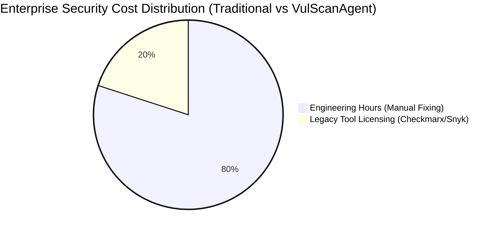

# 💰 Realistic Cost Estimation & ROI Model: 1, 10, 100, and 1,000 Repositories

> **Executive Financial Guide**: Detailed unit economics, LLM token breakdown, compute infrastructure costs, and comparative ROI analysis of **VulScanAgent** scaling from a single repository to an enterprise fleet of 1,000 repositories.

---

## 🎯 1. Operational Parameters & Unit Economics

To establish a realistic cost model, we evaluate a standard enterprise engineering cadence:
- **Scan Frequency**: 10 scans per repository per month (1 scheduled weekly audit + ~6 CI/CD pull request or commit webhook triggers).
- **Vulnerability Density**: An average of 1 to 3 vulnerabilities detected and remediated per active repository per month.
- **Agent Token Usage per Scan**:
  - **Phase 1: Recon & Strategy**: ~1,500 input tokens, ~300 output tokens.
  - **Phase 2: Composite Scanning (SAST, SCA, Secrets, IaC)**: Local compute engines (Semgrep, pip-audit, regex, AST parser) $\to$ **$0.00 LLM Cost**.
  - **Phase 3: Adversarial CandidateVerifier**: ~1,200 input tokens, ~400 output tokens per finding.
  - **Phase 4: AST Patch Synthesis (FixArchitect)**: ~2,500 input tokens, ~800 output tokens per fix.
  - **Phase 5: SecurityReviewer & ErrorDiagnostician**: ~2,000 input tokens, ~500 output tokens.
  - **Phase 6: PR Documentation (PRAuditor)**: ~1,500 input tokens, ~600 output tokens.
  - **Average Total per Scan**: **~15,000 Input Tokens** + **~4,000 Output Tokens**.

### Current Model Pricing (Per Million Tokens)

| AI Engine Tier | Input Cost / 1M Tokens | Output Cost / 1M Tokens | Cost per Full Scan Run |
|---|:---:|:---:|:---:|
| **Google Gemini 3.5 / 3.6 Flash** | $0.075 | $0.300 | **$0.0023** (Less than a 1/4 cent) |
| **Tiered Hybrid (Gemini Flash triage + Claude 3.5 Sonnet / GPT-4o patch)** | Blended ($0.80) | Blended ($3.50) | **$0.0380** (~3.8 cents) |
| **Pure OpenAI GPT-4o** | $2.500 | $10.000 | **$0.0775** (~7.8 cents) |
| **Pure Anthropic Claude 3.5 Sonnet** | $3.000 | $15.000 | **$0.1050** (~10.5 cents) |

---

## 📊 2. Master Cost Scaling Table: 1, 10, 100, and 1,000 Repositories

*Assumes a Tiered Hybrid architecture (Gemini Flash for rapid multi-layer triage & adversarial filtering + Claude 3.5 Sonnet / GPT-4o for complex AST patch generation).*

| Repository Fleet Size | Total Monthly Scans | Monthly AI Token Cost (Gemini Flash) | Monthly AI Token Cost (Hybrid Model) | Compute Cost (GH Actions / Docker VM) | Total Monthly VulScanAgent Cost | Legacy Tool Cost (Checkmarx / Snyk) | Annual Net Financial Savings |
|---|:---:|:---:|:---:|:---:|:---:|:---:|:---:|
| **1 Repository** *(Individual Dev / Microservice)* | **10** | $0.02 | **$0.38** | $0.00 *(Free Tier)* | **< $0.50 / mo** | $100 – $250 / mo | **~$1,200 – $3,000 / yr** |
| **10 Repositories** *(Startup / Small Team)* | **100** | $0.23 | **$3.80** | $1.00 *(CI runner minutes)* | **~$4.80 / mo** | $1,200 – $3,500 / mo | **~$14,000 – $42,000 / yr** |
| **100 Repositories** *(Mid-Sized Tech Company)* | **1,000** | $2.30 | **$38.00** | $15.00 *(or a $20/mo cloud VM)* | **~$53.00 / mo** | $6,000 – $18,000 / mo | **~$70,000 – $215,000 / yr** |
| **1,000 Repositories** *(Large Enterprise / Multi-Org)* | **10,000** | $23.00 | **$380.00** | $80.00 *(Kubernetes cluster)* | **~$460.00 / mo** | $25,000 – $75,000 / mo | **~$300,000 – $900,000 / yr** |

---

## 🔍 3. Deep-Dive Tier Breakdown

### Tier 1: 1 Repository (Solo Developer / Single Service)
- **Profile**: A developer maintaining an open-source project or single FastAPI/Node microservice.
- **Usage**: 10 scans per month (2 full weekly audits + ~8 commit pushes).
- **AI Token Breakdown**:
  - Gemini 3.5 Flash: **$0.02 / month** (100% covered under Google Gemini's Free Tier quota of 1,500 requests/day).
  - GPT-4o / Claude Sonnet: **~$0.78 / month**.
- **Compute Cost**: $0.00 (within GitHub Actions 2,000 free monthly minutes or run locally via CLI).
- **Total Cost**: **Under $1.00 / month** (literally free with Gemini API).
- **Comparison**: Snyk Developer tier ($25/mo) or SonarCloud ($10/mo) without any automated fix capabilities.

---

### Tier 2: 10 Repositories (Startup / Growth Team)
- **Profile**: 5–15 engineers managing a microservice backend, frontend web app, and infrastructure configs.
- **Usage**: 100 scans per month (~2.5 scans per day across all repositories).
- **AI Token Breakdown**:
  - Gemini Flash: **$0.23 / month**.
  - Hybrid Mode: **$3.80 / month**.
  - Pure Claude 3.5 Sonnet: **$10.50 / month**.
- **Compute Cost**: ~$1.00 to $2.00 in GitHub Actions minutes, or run on a tiny background worker.
- **Total Cost**: **~$5.00 / month ($60 / year)**.
- **Comparison**: Snyk Team Tier ($59/dev/mo for 10 devs = **$7,080 / year**) or Checkmarx startup plan ($15,000 / year).
- **Direct Annual Savings**: **Over $7,000 in software licenses alone**.

---

### Tier 3: 100 Repositories (Mid-Sized Enterprise / Scale-Up)
- **Profile**: 50–100 engineers managing multi-tier applications, Kubernetes services, internal libraries, and micro frontends.
- **Usage**: 1,000 scans per month (~33 scans per day triggered via PR webhooks and nightly scheduled audits).
- **AI Token Breakdown**:
  - Gemini Flash: **$2.30 / month**.
  - Hybrid Mode: **$38.00 / month**.
  - Pure GPT-4o: **$77.50 / month**.
- **Compute Infrastructure**:
  - A dedicated 2-vCPU / 4GB RAM cloud VM (e.g. AWS `t3.medium` or GCP `e2-medium`) running the VulScanAgent FastAPI webhook daemon: **$25.00 / month**.
- **Total Cost**: **~$63.00 / month (~$750 / year)**.
- **Comparison**:
  - Snyk Enterprise: **~$50,000 / year**.
  - Checkmarx One: **~$65,000 / year**.
  - Wiz: **~$60,000 / year**.
- **Direct Annual Savings**: **$49,000 to $64,000+ per year**.

---

### Tier 4: 1,000 Repositories (Large Global Enterprise / Financial Conglomerate)
- **Profile**: 500+ engineers across multiple organizations, hundreds of polyglot microservices, legacy apps, and monorepos.
- **Usage**: 10,000 scans per month (~330 scans per day distributed across global CI/CD pipelines).
- **AI Token Breakdown**:
  - Gemini Flash: **$23.00 / month**.
  - Hybrid Mode: **$380.00 / month**.
  - Pure Claude 3.5 Sonnet: **$1,050.00 / month**.
- **Compute Infrastructure**:
  - Autoscaling container deployment in Kubernetes (EKS/GKE) with horizontal pod autoscalers handling concurrent webhook bursts: **~$80.00 to $120.00 / month**.
- **Total Cost**: **~$460.00 / month (~$5,500 / year)**.
- **Comparison**:
  - Enterprise Checkmarx + Snyk contracts at 1,000 repos routinely exceed **$250,000 to $500,000+ annually**.
- **Direct Annual Savings**: **Over $240,000 to $490,000 annually**.

---

## 📈 4. The Hidden ROI: Engineering Labor Savings

Software licensing represents only **20%** of an enterprise's true security costs. The remaining **80% is developer time** lost to manual vulnerability triage, research, and coding.

### Quantifying Developer Hours Saved

| Organization Scale | Estimated Real Vulnerabilities / Year | Hours per Manual Fix (Triage, Research, Fix, Test) | Total Engineering Hours Spent (Traditional) | Engineering Labor Cost (@ $100/hr) | VulScanAgent Autonomous Labor Cost (2-min PR review) | Net Annual Engineering Savings |
|---|:---:|:---:|:---:|:---:|:---:|:---:|
| **10 Repos** | 25 | 4 hours | 100 hours | $10,000 | $83 | **$9,917 / year** |
| **100 Repos** | 250 | 4 hours | 1,000 hours | $100,000 | $833 | **$99,167 / year** |
| **1,000 Repos** | 2,500 | 4 hours | 10,000 hours | **$1,000,000** | $8,333 | **$991,667 / year** |

> 💡 **Takeaway**: In a 1,000-repository enterprise, VulScanAgent saves **nearly $1,000,000 in diverted engineering capacity** by transforming 4-hour manual debugging cycles into 2-minute Pull Request reviews.

---

## 🛡️ 5. Cost Guardrails & Optimization Best Practices

To ensure costs stay predictable and minimal at scale:

1. **Local AST Pre-Filtering**:
   - VulScanAgent runs Semgrep, regex, and AST scanners locally *before* invoking LLMs. If zero candidates are found, **$0.00 in LLM tokens are consumed**.
2. **Adversarial Validation Caching**:
   - The adversarial `CandidateVerifier` immediately drops false positives before reaching the `FixArchitect` phase, saving up to **60% of downstream token consumption**.
3. **Provider Failover & Tiering**:
   - VulScanAgent's built-in provider router can be configured to use **Gemini 3.5/3.6 Flash** as primary (lowest cost, sub-second latency) and selectively escalate to **Claude 3.5 Sonnet** only when complex AST logic requires multi-attempt self-healing.
4. **Zero Auto-Merge Policy**:
   - Eliminates runaway compute or uncontrolled branch proliferation by enforcing strict human sign-off gates.
